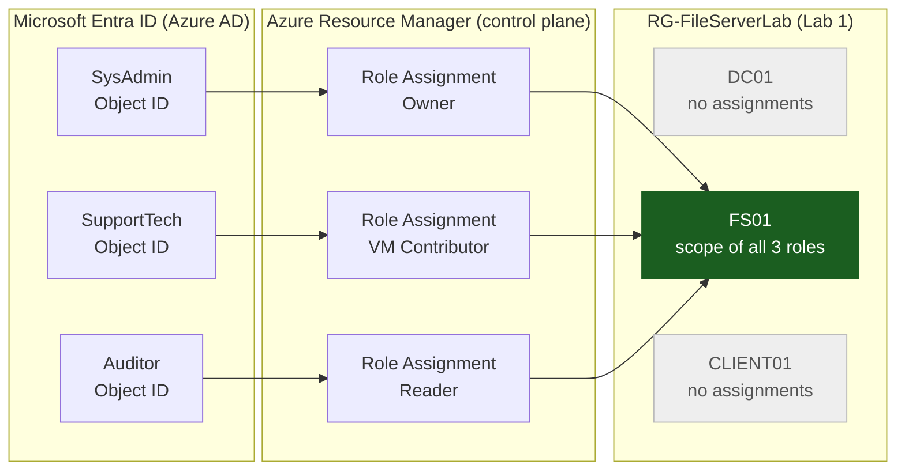
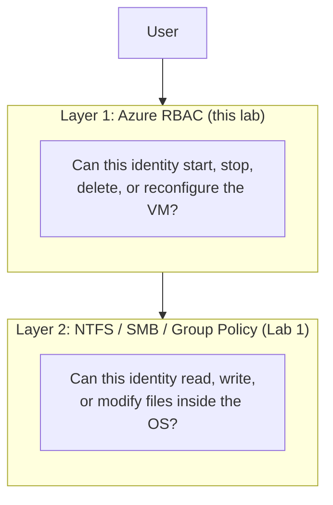
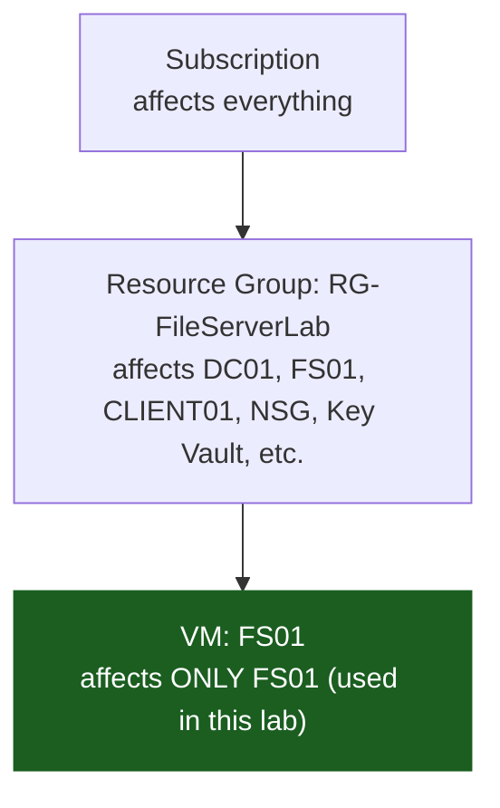
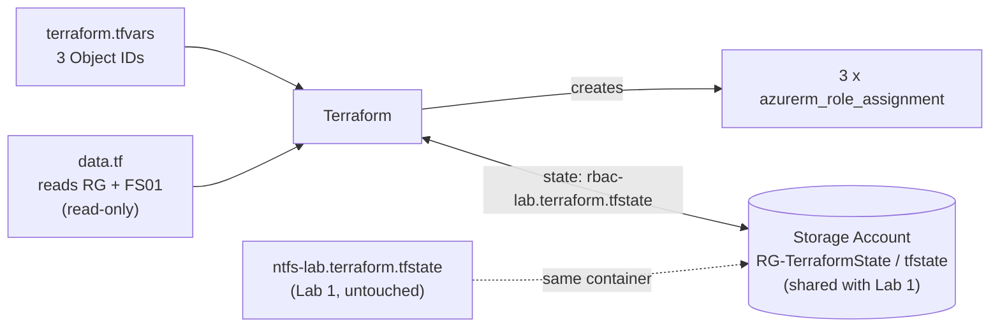

# Azure RBAC Access Control

**Owner · Virtual Machine Contributor · Reader — scoped to a single VM (FS01) · Terraform + PowerShell**


> Lab 1 controlled who can access **files inside** a VM. This lab controls who can manage **the VM itself** from Azure, using role-based access control (RBAC) scoped to the narrowest possible target: one resource.

## [🎬 Watch Me Build This Lab!](https://streamable.com/7ndn34)

---

## Table of Contents

1. [Overview](#overview)
2. [Scenario](#scenario)
3. [Architecture](#architecture)
4. [How This Lab Fits Into the Series](#how-this-lab-fits-into-the-series)
5. [Prerequisites](#prerequisites)
6. [Repository Structure](#repository-structure)
7. [Design Decisions](#design-decisions)
8. [Deployment Guide](#deployment-guide)
9. [Validation and Persona Testing](#validation-and-persona-testing)
10. [Permission Matrix](#permission-matrix)
11. [Security Considerations](#security-considerations)
12. [Troubleshooting](#troubleshooting)
13. [Teardown](#teardown)
14. [Skills Demonstrated](#skills-demonstrated)

---

## Overview

| | |
|---|---|
| **Goal** | Enforce least privilege on an Azure VM using three built-in RBAC roles, each assigned to a different persona |
| **What gets created** | 3 role assignments on FS01 only. No new VMs, networking, or resource groups |
| **Depends on** | Lab 1 (NTFS File Server). `RG-FileServerLab` and `FS01` must already exist |
| **Tooling** | Terraform (>= 1.5.0), Azure CLI, PowerShell |
| **Deploy time** | Under 1 minute (plus 2 to 10 minutes for RBAC propagation) |
| **Cost** | Role assignments are free. Only Lab 1's VM compute incurs charges |

Azure RBAC operates at the **Azure Resource Manager control plane**, which is entirely separate from the NTFS permissions enforced inside the Windows OS. A file server with perfect NTFS permissions but no RBAC control is still a risk: anyone with portal access and a broad role could stop, resize, or delete the VM underneath it. This lab closes that gap.

## Scenario

A help desk ticket comes in: the Finance file server is unresponsive.

- The **on-call technician** (SupportTech) restarts FS01 from Azure. They cannot delete it, change its configuration, or see who else has access to it.
- An **auditor** performs a quarterly review. They can view FS01's configuration for compliance reporting but cannot take any action.
- After a staff change, the **senior sysadmin** uses Owner rights to reassign roles.

Each persona has exactly what the job requires, and nothing more.

| Persona | Role | Real-world job function |
|---|---|---|
| SysAdmin | **Owner** | Full control of FS01, including managing who else has access |
| SupportTech | **Virtual Machine Contributor** | Start, stop, and restart FS01. No delete, no RBAC |
| Auditor | **Reader** | View-only visibility for compliance. No actions of any kind |

---

## Architecture

### Control plane view: who can do what to FS01

All three role assignments are scoped to **FS01's resource ID**. DC01 and CLIENT01 live in the same resource group but receive no assignments from this lab.



### Two layers of access control on the same VM



### Why scope matters

The `scope` argument is the most important line in each role assignment. The same role at a different scope has a very different blast radius.



### Terraform and state flow



---

## How This Lab Fits Into the Series

| Lab | What it deploys | Relationship |
|---|---|---|
| **Lab 1: NTFS File Server** | DC01, FS01, CLIENT01, VNet, NSG, Key Vault in `RG-FileServerLab` | Standalone. Creates all infrastructure |
| **Lab 2: Azure RBAC** (this lab) | 3 role assignments on FS01 only | **Depends on Lab 1.** Reads its resources via data sources and reuses its storage account |
| **Azure Update Manager Lab** | DC01, WS01, WS02, VNet, Key Vault in `rg-aumlab` | Standalone. Independent of Labs 1 and 2 |

**Remote state:** Lab 2 reuses Lab 1's storage account (`RG-TerraformState`). Only the state key differs (`rbac-lab.terraform.tfstate` vs `ntfs-lab.terraform.tfstate`), so each lab's `terraform destroy` can never remove the other's resources.

---

## Prerequisites

```powershell
terraform -version   # Must be >= 1.5.0
az version           # Any recent Azure CLI

# Confirm correct subscription
az account show
# If wrong: az account set --subscription "<name or ID>"

# Confirm Lab 1 VMs are running
az vm list -g RG-FileServerLab --query "[].{name:name,status:powerState}" -o table
# All three must show: VM running
# If stopped: az vm start --ids $(az vm list -g RG-FileServerLab --query "[].id" -o tsv)
```

You also need **three existing Entra ID test accounts** (not your own) to act as SysAdmin, SupportTech, and Auditor.

> **MFA on test accounts:** the persona tests require `az login` as each test user. If your tenant enforces MFA, use a Conditional Access exclusion for these accounts or a test tenant without MFA.

---

## Repository Structure

```
rbac-lab-terraform/
├── backend.tf                 # Reuses Lab 1 storage account, different state key
├── versions.tf                # Provider version requirements
├── variables.tf               # Three Object ID inputs with NO defaults
├── data.tf                    # Reads Lab 1 resource group and FS01 (read-only)
├── rbac.tf                    # The three role assignments scoped to FS01
├── outputs.tf                 # VM ID, resource group, role assignment IDs
├── terraform.tfvars.example   # Safe template (committed)
├── terraform.tfvars           # Real Object IDs (NEVER committed)
├── .gitignore
├── validate-lab.ps1           # Confirms assignments, prints matrix, exports report
└── scripts/
    └── 01-get-object-ids.ps1  # Translates user emails to Entra ID Object IDs
```

---

## Design Decisions

| Component | Purpose and rationale |
|---|---|
| **`data.tf` (data sources)** | Reads Lab 1's resource group and FS01 by name without modifying them. Terraform needs FS01's full resource ID to create role assignments. If Lab 1 is not deployed, the lookup fails with a clear error instead of creating anything |
| **`rbac.tf` (role assignments)** | Three assignments, each with `scope = data.azurerm_virtual_machine.fs01.id`. Pointing the scope at the resource group instead would silently grant the role over every resource in `RG-FileServerLab` |
| **Object IDs, not emails** | Role assignments require the principal's Object ID. UPNs and email addresses can change; Object IDs are immutable |
| **No defaults on Object ID variables** | A careless deploy can never assign roles to placeholder identities. Terraform fails loudly if the values are missing |
| **Separate state key** | Prevents Lab 2's `terraform destroy` from touching Lab 1's resources |
| **`validate-lab.ps1`** | `terraform apply` proves Terraform created the resource, not that Azure RBAC has propagated the permission. The script queries live RBAC state and exports an auditable report |

### Core Terraform

**`data.tf`**

```hcl
# Read Lab 1's resource group (subscription context)
data "azurerm_resource_group" "lab" {
  name = var.resource_group_name
}

# Read FS01 by name to obtain its full resource ID.
# Scoping to the VM ID   = role applies ONLY to FS01.
# Scoping to the RG ID   = role applies to DC01, FS01, CLIENT01, and everything else.
data "azurerm_virtual_machine" "fs01" {
  name                = var.vm_name
  resource_group_name = data.azurerm_resource_group.lab.name
}
```

**`rbac.tf`**

```hcl
# Owner: full control on FS01, including assigning and removing roles
resource "azurerm_role_assignment" "sysadmin_owner" {
  scope                = data.azurerm_virtual_machine.fs01.id
  role_definition_name = "Owner"
  principal_id         = var.sysadmin_object_id
}

# Virtual Machine Contributor: start, stop, restart. No delete, resize, or RBAC changes
resource "azurerm_role_assignment" "supporttech_vm_contributor" {
  scope                = data.azurerm_virtual_machine.fs01.id
  role_definition_name = "Virtual Machine Contributor"
  principal_id         = var.support_user_object_id
}

# Reader: view configuration and status. No actions of any kind
resource "azurerm_role_assignment" "auditor_reader" {
  scope                = data.azurerm_virtual_machine.fs01.id
  role_definition_name = "Reader"
  principal_id         = var.auditor_object_id
}
```

---

## Deployment Guide

### Step 1: Create the project folder

Use a folder separate from Lab 1. The two are independent Terraform projects and must never share a folder or a state key.

```powershell
New-Item -ItemType Directory -Path "$HOME\rbac-lab-terraform"
cd "$HOME\rbac-lab-terraform"
New-Item -ItemType Directory -Path scripts
```

### Step 2: Configure the backend

In `backend.tf`, replace `REPLACE_WITH_YOUR_LAB1_STORAGE_ACCOUNT_NAME` with the storage account name used in Lab 1.

```hcl
terraform {
  backend "azurerm" {
    resource_group_name  = "RG-TerraformState"
    storage_account_name = "REPLACE_WITH_YOUR_LAB1_STORAGE_ACCOUNT_NAME"
    container_name       = "tfstate"
    key                  = "rbac-lab.terraform.tfstate"   # Lab 1 uses ntfs-lab.terraform.tfstate
  }
}
```

### Step 3: Look up Object IDs

```powershell
.\scripts\01-get-object-ids.ps1
```

The script prompts for the UPN of each test user, resolves it with `az ad user show`, and prints lines ready to paste into `terraform.tfvars`.

| Role assigned | User UPN | Object ID |
|---|---|---|
| SysAdmin: Owner | *(your test account)* | *(from script output)* |
| SupportTech: VM Contributor | *(your test account)* | *(from script output)* |
| Auditor: Reader | *(your test account)* | *(from script output)* |

### Step 4: Configure variables

```powershell
Copy-Item terraform.tfvars.example terraform.tfvars
```

Edit `terraform.tfvars`:

```hcl
resource_group_name    = "RG-FileServerLab"   # Case-sensitive. Must match Lab 1 exactly
vm_name                = "FS01"               # Case-sensitive. Must match Lab 1 exactly
location               = "Central US"

sysadmin_object_id     = "<object-id>"
support_user_object_id = "<object-id>"
auditor_object_id      = "<object-id>"
```

### Step 5: Deploy

```powershell
az login
az account show
terraform init
terraform plan     # Must show exactly 3 resources to add
terraform apply    # Type yes. Completes in under 1 minute
```

> **Checkpoint:** if `plan` shows more than 3 resources, stop. A mismatch in `resource_group_name` or `vm_name` (including capitalization) is the most likely cause. The plan must contain no VMs, no networking, and no resource groups.

### Step 6: Validate

RBAC propagation can take a few minutes. Wait 2 to 3 minutes, then run:

```powershell
.\validate-lab.ps1
```

The script:

1. Resolves FS01's resource ID
2. Queries **live** role assignments at that scope
3. Prints `[PASS]` or `[FAIL]` for each of the three expected roles
4. Prints the permission matrix
5. Exports `RBAC_Lab_Report.txt` (git-ignored) with an overall `ALL PASS` or `FAILURES DETECTED` result

If it reports `FAIL` after 5 minutes, wait and re-run. Propagation can take up to 10 minutes in some tenants.

---

## Validation and Persona Testing

Role assignments are only proven when you test both what each identity **can** do and what it **cannot** do. Open a fresh terminal per persona. The expected failures are not errors: they are the evidence that least privilege is being enforced.

| # | Persona (login) | Command | Expected result | What it proves |
|---|---|---|---|---|
| 1a | Auditor | `az vm show -g RG-FileServerLab -n FS01` | **Succeeds** | Reader can view VM details |
| 1b | Auditor | `az vm stop -g RG-FileServerLab -n FS01` | **Fails** (`AuthorizationFailed`) | Reader cannot take actions |
| 2a | SupportTech | `az vm start -g RG-FileServerLab -n FS01` | **Succeeds** | VM Contributor can manage availability |
| 2b | SupportTech | `az role assignment list --scope <FS01 ID>` | **Fails** (`AuthorizationFailed`) | VM Contributor cannot see or manage RBAC |
| 3a | SysAdmin | `az vm show -g RG-FileServerLab -n FS01` | **Succeeds** | Owner has full visibility |
| 3b | SysAdmin | `az role assignment list --scope <FS01 ID>` | **Succeeds** | Owner can view and manage RBAC |

```powershell
# Example: Test 1, Auditor (Reader)
az login   # sign in as the Auditor test account
az vm show -g RG-FileServerLab -n FS01 --query "{name:name,size:hardwareProfile.vmSize}"   # succeeds
az vm stop -g RG-FileServerLab -n FS01                                                       # AuthorizationFailed

# Example: Test 2b, SupportTech (VM Contributor)
az login   # sign in as the SupportTech test account
az role assignment list --scope $(az vm show -g RG-FileServerLab -n FS01 --query id -o tsv)  # AuthorizationFailed

# Restore your own session when finished
az login
az account show
```

> If the Auditor's `az vm stop` unexpectedly succeeds, RBAC is likely still propagating. Wait 5 minutes and retest.

### Evidence

Add your own screenshots here to show the work was performed. Suggested captures:

- [ ] `terraform plan` showing exactly 3 resources to add
- [ ] `terraform apply` complete
- [ ] `validate-lab.ps1` output with `ALL PASS` and the permission matrix
- [ ] Portal view of FS01 → Access control (IAM) → Role assignments
- [ ] Each `AuthorizationFailed` result from the persona tests
- [ ] The exported `RBAC_Lab_Report.txt`

---

## Permission Matrix

Effective Azure control-plane permissions on **FS01 only**:

| Action | Owner | VM Contributor | Reader |
|---|:---:|:---:|:---:|
| View VM details | Yes | Yes | Yes |
| Start / Stop VM | Yes | Yes | No |
| Connect to VM | Yes | Yes | No |
| Delete VM | Yes | No | No |
| Manage RBAC roles | Yes | No | No |

> **Note on "Connect":** RBAC governs the Azure control plane. Signing in to the Windows OS is still governed by the operating system's own authentication and by the NTFS, SMB, and Group Policy controls configured in Lab 1.

---

## Security Considerations

**Lab shortcuts vs. production practice**

| Lab choice | Production recommendation |
|---|---|
| **Owner** assigned directly to a user | Owner combines full control and the ability to grant access. Split it into Contributor plus User Access Administrator, and limit who holds either |
| Roles assigned to **individual users** | Assign roles to **Entra ID security groups** so access follows team membership and offboarding is a single change |
| **Permanent** assignments | Use **Privileged Identity Management (PIM)** for just-in-time, time-bound, approval-gated elevation of privileged roles |
| Test accounts excluded from MFA | Never exclude real users from MFA. Privileged roles should always require MFA via Conditional Access |
| Built-in roles only | Where built-in roles are too broad, define **custom roles** with only the required actions |
| No monitoring of RBAC changes | Alert on role assignment writes in the Azure **Activity Log** and review assignments on a recurring schedule (access reviews) |

**Practices this lab already follows**

- Narrowest possible scope (a single resource, not the group or subscription)
- Immutable Object IDs instead of email addresses
- No default values for identity inputs, so nothing is assigned by accident
- `terraform.tfvars` and state files excluded from version control
- Read-only data sources so the dependent lab's infrastructure is never modified
- Verification against live RBAC state, not just Terraform's report
- Negative testing (confirming what each role **cannot** do)

---

## Troubleshooting

| Problem | Cause | Solution |
|---|---|---|
| `terraform apply`: principal not found | Object ID is wrong or the account was deleted | Re-run `01-get-object-ids.ps1`, update `terraform.tfvars`, re-apply |
| `terraform apply`: resource group not found | Lab 1 is not deployed | Deploy the NTFS lab first. `RG-FileServerLab` must exist |
| Plan shows more than 3 resources | `resource_group_name` or `vm_name` mismatch | Check capitalization. `FS01` is not `fs01` |
| `validate-lab.ps1` shows FAIL after 10+ minutes | Assignment missing from Terraform state | Run `terraform state list` and confirm three `azurerm_role_assignment` resources. If missing, re-apply |
| `az vm stop` succeeds for Auditor | RBAC still propagating | Wait 5 minutes and retest |
| MFA prompt when logging in as a test user | Tenant enforces MFA | Create a Conditional Access exclusion for test accounts or use a test tenant |

---

## Teardown

```powershell
# Option A: remove RBAC only, keep Lab 1 VMs running
terraform destroy

# Option B: full teardown of both labs
terraform destroy                                        # Remove RBAC first
az group delete -n RG-FileServerLab --yes --no-wait      # Remove all Lab 1 resources
az group show -n RG-FileServerLab 2>&1                   # Expect: ResourceGroupNotFound
```

Always destroy Lab 2 **before** deleting Lab 1's resource group. Deallocate or delete Lab 1's VMs when you are finished to stop compute charges.

---

## Skills Demonstrated

| Skill | Real-world relevance |
|---|---|
| RBAC vs. NTFS: control plane vs. data plane | Both layers must be configured correctly. Securing one does not secure the other |
| Resource-level scoping | Limits blast radius if an account is compromised |
| Terraform data sources | The pattern for referencing infrastructure owned by another project or team |
| Entra ID Object ID lookup | A prerequisite for any production RBAC automation |
| Persona-based negative testing | Proves least privilege is enforced rather than assumed |
| Automated, auditable validation | Structured reports are the standard for compliance evidence |
| Remote state isolation | Safe coexistence of multiple Terraform projects in one backend |

---

## Related Labs

- **Lab 1: NTFS File Server** (prerequisite): Active Directory, NTFS permissions, SMB shares, Group Policy
- **Azure Update Manager Lab**: patch orchestration across Windows Server VMs

---

*Built and documented as a hands-on cloud security lab. All identities used were dedicated test accounts.*
